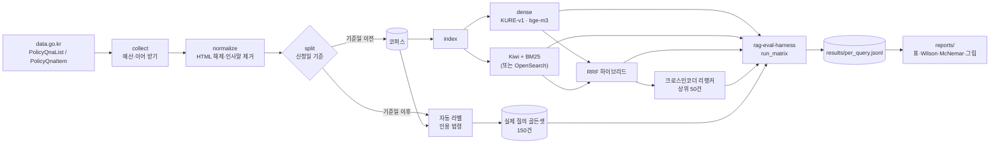

# 민원 RAG 검색 실험

[](https://github.com/parksungyun0411/minwon-rag/actions/workflows/ci.yml)  [](LICENSE)

국민권익위원회 「민원정책 질의응답」에 실제로 올라온 시민 질의로 유사 민원 검색 설정을 비교하는 실험 저장소입니다. dense 검색을 기준으로 두고, 한국어 BM25를 더한 하이브리드와 크로스인코더 리랭커를 차례로 붙여 지표가 어떻게 달라지는지 잽니다.

민원 질의는 시민이 쓴 구어체이고 기관 답변은 행정 문체라서 같은 내용도 어휘가 많이 어긋납니다. 어휘 일치에 기대는 BM25와 의미 유사도에 기대는 dense 검색의 결과가 갈리는 데이터라 하이브리드·리랭커의 효과를 보기에 맞다고 판단했습니다. 평가 질의는 LLM으로 합성하지 않고 실제 민원을 그대로 쓰며, 정답 라벨은 기관 답변에 붙은 인용 법령으로 자동 생성합니다.

> 현재 상태: 수집기·전처리·검색·평가 코드와 단위 테스트까지 완료했습니다. 공공데이터포털 인증키를 받기 전이라 실데이터 수집과 측정은 아직 하지 않았고, 아래 결과 표는 비어 있습니다.

## 구현 범위

- data.go.kr 「민원정책 질의응답 조회서비스」(15074671) 목록·항목 API 수집기: 일일 호출 예산, 이어 받기, 재시도
- 답변 본문 정규화: 이중 이스케이프된 HTML 해제, 기관 답변의 정형 인사말 제거
- 시점 분할: 기준일 이전 민원은 검색 코퍼스, 이후 민원 150건은 평가 질의
- 인용 법령 기반 관련성 자동 라벨(조문 일치 = 강, 법령·기관 일치 = 약)
- 검색기: dense(KURE-v1, bge-m3) · Kiwi 형태소 + BM25 · RRF 하이브리드 · bge-reranker 리랭킹
- 어휘 검색 백엔드 교체 가능: 프로세스 내 Kiwi+BM25(기본) / OpenSearch+nori(선택, 미검증)
- 설정 매트릭스(`configs/matrix.yaml`) 7종을 한 번에 실행하고 질의별 지표 저장
- 평가·통계·보고서는 [rag-eval-harness](https://github.com/parksungyun0411/rag-eval-harness)를 의존성으로 사용
- LLM 키가 있으면: 합성 질의 골든셋 생성, 답변 초안 표본 생성(하네스의 LLM 판정 입력)

## 아키텍처



검색 설정은 다음 일곱 가지입니다. 기준 설정은 `dense-kure`이고, 나머지는 모두 이 설정 대비 McNemar 검정을 붙입니다.

| 설정 | dense | 어휘 | 리랭커 |
|---|---|---|---|
| `bm25` | | Kiwi+BM25 | |
| `dense-kure` (기준) | KURE-v1 | | |
| `dense-bge-m3` | bge-m3 | | |
| `hybrid-kure` | KURE-v1 | Kiwi+BM25 | |
| `hybrid-bge-m3` | bge-m3 | Kiwi+BM25 | |
| `hybrid-kure-rerank` | KURE-v1 | Kiwi+BM25 | bge-reranker-v2-m3 |
| `hybrid-bge-m3-rerank` | bge-m3 | Kiwi+BM25 | bge-reranker-v2-m3 |

## 기술 스택

| 영역 | 기술 |
|---|---|
| 언어 |   |
| 수집 |  |
| 한국어 처리 |  |
| 검색 |    |
| 모델 |    |
| 평가 |  |
| 코드 품질 |    |

## 규모·성능

측정 전 — `make eval` 실행 후 자동 생성

데이터 규모(`reports/data.md`):

| 지표 | 수치 |
|---|---:|
| 수집 레코드 | |
| 분할 기준일 | |
| 코퍼스 | |
| 평가 질의 | |
| 평가 질의당 관련 문서(중앙값) | |

검색 설정 비교(실제 질의 골든셋, `reports/retrieval.md`):

| 설정 | hit@1 | hit@10 | recall@10 | MRR | nDCG@10 | p95 지연(ms) |
|---|---:|---:|---:|---:|---:|---:|
| `bm25` | | | | | | |
| `dense-kure` (기준) | | | | | | |
| `dense-bge-m3` | | | | | | |
| `hybrid-kure` | | | | | | |
| `hybrid-bge-m3` | | | | | | |
| `hybrid-kure-rerank` | | | | | | |
| `hybrid-bge-m3-rerank` | | | | | | |

## 핵심 설계 판단

- **평가 질의는 시점으로 나눴습니다.** 신청일이 기준일 이전인 민원만 검색 코퍼스에 넣고, 이후 민원에서 평가 질의를 뽑습니다. "과거 처리 사례로 새 민원에 답한다"는 실제 사용 순서와 같고, 평가 질의 자신이 코퍼스에 들어가는 누수가 생기지 않습니다. 기준일을 정하지 않으면 신청일 90 분위수를 씁니다.
- **관련성 라벨은 인용 법령으로 자동 생성했습니다.** 항목 API의 `lawList`에 기관 답변이 인용한 법령·조문이 들어 있습니다. 조문까지 같은 과거 민원은 grade 2, 법령명과 처리기관이 같으면 grade 1입니다. 처리기관만 같은 경우는 라벨로 쓰지 않았습니다. 한 기관 아래 민원이 많아 관련 문서가 지나치게 늘어나고 recall이 의미를 잃기 때문입니다. 같은 이유로 관련 문서가 100건을 넘는 질의는 평가에서 뺍니다.
- **문서 단위는 민원 1건입니다.** 제목·질의·답변을 이어 붙여 벡터 하나로 만들고, 모델 최대 길이(512토큰)에서 자릅니다. 청킹 방식 비교는 이번 범위에서 뺐습니다.
- **BM25는 프로세스 안에서 직접 구현했습니다.** Kiwi 형태소 분석 결과에서 명사·어근·동사/형용사 어간·외국어만 남기고, 문서별 BM25 항 가중치를 희소 행렬로 미리 계산해 질의 시에는 열 합만 구합니다. Docker 없이 `make index`만으로 돌아가게 하려는 선택이고, 같은 인터페이스로 OpenSearch+nori 백엔드도 붙여 두었습니다(아래 한계 참고).
- **하이브리드 결합은 RRF(k=60)를 썼습니다.** BM25 점수와 코사인 유사도는 척도가 달라 정규화 방식에 따라 결과가 바뀝니다. 순위만 쓰는 RRF는 이 선택을 없앱니다.
- **리랭커는 상위 50건만 다시 매깁니다.** 그 뒤 순위는 하이브리드 순서를 그대로 두어 recall@k 계산 범위(최대 100)를 유지합니다.
- **수집은 하루 호출 한도를 전제로 했습니다.** 개발계정은 하루 10,000건이고, 질의·답변 본문은 건별 항목 API로만 받을 수 있습니다. 하루 예산(기본 9,500건)에 닿으면 받은 데까지 저장하고 멈추며, 다음 날 같은 명령을 실행하면 받지 않은 건만 이어 받습니다.
- **기관 답변의 정형 인사말을 지웠습니다.** "안녕하십니까? … 감사드립니다", "… 기원합니다" 같은 문장은 거의 모든 답변에 들어 있어 검색 신호가 아니라 잡음입니다. 규칙에 맞는 첫·끝 문장만 지우고, 지운 결과가 비면 원문을 남깁니다.
- **평가 코드는 복사하지 않고 의존성으로 씁니다.** 지표·Wilson 구간·McNemar 검정·보고서는 `rag-eval-harness`에 있고, 이 저장소는 검색기와 데이터만 맡습니다. 질의별 지표를 `results/per_query.jsonl`로 남겨 평균·신뢰구간·검정을 같은 원자료에서 다시 계산합니다.

## 실행 방법

필요한 도구는 Python 3.12와 uv입니다. 단위 테스트는 키·모델 없이 돌아갑니다.

```bash
uv sync
make test
make lint
```

실데이터 실험에는 공공데이터포털에서 「국민권익위원회_민원정책 질의응답조회서비스」 활용신청(자동승인)을 하고 받은 인증키가 필요합니다.

```bash
cp .env.example .env          # DATA_GO_KR_SERVICE_KEY 에 일반 인증키(Decoding) 입력
make setup                    # sentence-transformers·torch 포함 설치
make collect                  # 하루 한도에 닿으면 멈춤 → 다음 날 다시 실행
make index                    # 시점 분할·자동 라벨·임베딩·BM25 색인
make eval                     # 7개 설정 × 골든셋
make report                   # reports/ 생성
```

LLM 키가 있으면 합성 질의 골든셋과 답변 초안 표본을 더 만들 수 있습니다. 두 골든셋 비교와 LLM 판정은 `rag-eval-harness`의 `make eval`이 이 저장소의 타깃을 불러 실행합니다.

```bash
make synth                    # data/golden/synthetic (LLM_PROVIDER, LLM_MODEL 필요)
make eval                     # 실제·합성 골든셋 모두 실행
make answers                  # results/answers.jsonl
```

| 설정 | 환경 변수 |
|---|---|
| 분할 기준일 | `SPLIT_CUTOFF=YYYY-MM-DD` |
| 평가 질의 수 | `EVAL_SIZE=150` |
| 어휘 검색 백엔드 | `LEXICAL_BACKEND=kiwi_bm25` 또는 `opensearch` |
| 모델 장치 | `MODEL_DEVICE=mps` (비우면 자동) |
| 검색 설정·모델 | `configs/matrix.yaml` |

## 재현

`make report`가 `reports/`에 아래 파일을 씁니다. 표의 숫자는 모두 `results/`의 원자료에서 다시 계산하며, 손으로 적지 않습니다.

| 파일 | 내용 |
|---|---|
| `reports/data.md` | 수집 건수, 분할 기준일, 코퍼스·평가 질의 수, 라벨 분포 |
| `reports/retrieval.md` | 설정별 hit@k·recall@k·MRR·nDCG·mAP, hit@10 Wilson 구간, 기준 설정 대비 McNemar, p95 지연 |
| `reports/recall_at_k_<골든셋>.png` | 설정별 recall@k 곡선 |

## 프로젝트 구조

```text
minwon-rag/
├── src/minwon_rag/
│   ├── collect.py        목록·항목 API 수집기
│   ├── normalize.py      HTML 해제, 인사말 제거, 레코드 정규화
│   ├── labels.py         인용 법령 기반 관련성 라벨
│   ├── split.py          시점 분할, 평가 질의 추출
│   ├── lexical.py        Kiwi 토크나이저, BM25
│   ├── dense.py          임베딩, 전수 탐색
│   ├── fusion.py         RRF, 크로스인코더 리랭커
│   ├── opensearch_backend.py  선택 백엔드(미검증)
│   ├── pipeline.py       설정 매트릭스 → 검색기, 색인 생성
│   ├── answer.py         답변 초안 표본
│   └── cli.py            minwon 명령
├── configs/matrix.yaml   검색 설정 7종과 모델
├── tests/                단위 테스트, 합성 API 응답 픽스처
├── reports/              make report 결과
├── results/              질의별 원자료
└── docker-compose.yml    OpenSearch+nori (미검증)
```

## 한계

- 아직 실데이터로 측정하지 않았습니다. 결과 표가 비어 있는 이유입니다.
- API 명세는 data.go.kr 페이지의 항목 표와 기관 참고문서의 응답 예시로 맞췄습니다. 응답을 감싸는 키(`resultList`, `resultData`, `lawList`)는 참고문서 예시에서만 확인했고, `firstIndex`가 페이지 번호인지 레코드 오프셋인지는 첫 호출에서 확인해야 합니다. 수집기는 연속 페이지가 절반 이상 겹치면 멈추고 경고를 남깁니다.
- 답변에 인용 법령(`lawList`)이 붙은 비율을 아직 모릅니다. 비율이 낮으면 평가 질의 후보가 부족해지고, `make index` 단계에서 오류로 알려 줍니다.
- 자동 라벨은 "같은 법 조항을 근거로 답한 과거 민원"이라는 대리 지표입니다. 사람이 판정한 주제 관련성과 같지 않으며, 관련 있는 민원인데 인용 법령이 없어 라벨에서 빠지는 경우가 있습니다.
- OpenSearch 백엔드와 `docker-compose.yml`은 작성만 했고 실행해 보지 않았습니다. 개발 환경에 Docker가 없었습니다.
- 청킹 비교, 답변 거절률, 인용 법령 F1은 이번 범위에서 뺐습니다.
- CI는 `rag-eval-harness`를 GitHub에서 받아 설치합니다. 하네스 저장소가 비공개인 동안에는 저장소 시크릿 `HARNESS_TOKEN`(읽기 권한)이 있어야 CI가 통과합니다.

## 라이선스

코드는 [MIT](LICENSE) 라이선스를 따릅니다. 수집 데이터는 저장소에 포함하지 않으며, 이용 조건은 [공공데이터포털 데이터 페이지](https://www.data.go.kr/data/15074671/openapi.do)를 따릅니다.
