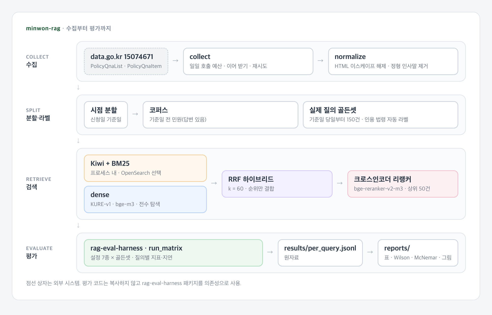

# 민원 RAG 검색 실험

[](https://github.com/parksungyun0411/minwon-rag/actions/workflows/ci.yml)  [](LICENSE)

국민권익위원회 「민원정책 질의응답」에 실제로 올라온 시민 질의로 유사 민원 검색 설정을 비교하는 실험 저장소입니다. dense 검색을 기준으로 두고, 한국어 BM25를 더한 하이브리드와 크로스인코더 리랭커를 차례로 붙여 지표가 어떻게 달라지는지 측정합니다.

민원 질의는 시민이 쓴 구어체이고, 기관 답변은 행정 문체입니다. 같은 내용이라도 쓰는 단어가 달라, 어휘 일치에 기대는 BM25와 의미 유사도에 기대는 dense 검색은 서로 다른 문서를 찾아올 수 있습니다. 평가 질의는 LLM으로 합성하지 않고 실제 민원을 그대로 쓰며, 정답 라벨은 기관 답변에 붙은 인용 법령으로 자동 생성합니다.

2026-10-26~27에 실제 민원 16,715건을 수집해 검색 설정 7종을 측정했습니다. 실제 질의 150건으로는 설정 사이의 hit@10 차이를 가려낼 수 없었습니다(기준 설정 대비 McNemar p ≥ 0.6, 설정별 95% 구간도 모두 겹침). 하이브리드는 dense보다 1위 적중과 MRR이 높았고(검정 안 함), 리랭커는 정확도 차이를 보이지 못한 채 지연이 약 100배로 늘었습니다([평가](#평가)).

## 구현 범위

- data.go.kr 「민원정책 질의응답 조회서비스」(15074671) 목록·항목 API 수집기: 일일 호출 예산, 이어 받기, 재시도
- 답변 본문 정규화: 이중 이스케이프된 HTML 해제, 기관 답변의 정형 인사말 제거
- 시점 분할: 기준일 전 민원(답변 있음)은 검색 코퍼스, 기준일 당일부터의 민원 가운데 150건은 평가 질의
- 인용 법령 기반 관련성 자동 라벨(조문 일치 = grade 2, 법령명·처리기관 일치 = grade 1)
- 검색기: dense(KURE-v1, bge-m3), Kiwi 형태소 + BM25, RRF 하이브리드, bge-reranker-v2-m3 리랭킹
- 어휘 검색 백엔드 교체: 프로세스 내 Kiwi+BM25(기본), OpenSearch+nori(선택, 미검증)
- 설정 매트릭스(`configs/matrix.yaml`) 7종을 한 번에 실행하고 질의별 지표 저장
- 지표·통계·보고서는 [rag-eval-harness](https://github.com/parksungyun0411/rag-eval-harness)를 의존성으로 사용
- LLM 키가 있을 때: 합성 질의 골든셋 생성, 답변 초안 표본 생성(하네스 LLM 판정의 입력)

## 아키텍처



검색 설정은 일곱 가지입니다. 기준 설정은 `dense-kure`이고, 나머지 설정은 모두 기준 설정과 hit@10을 McNemar 검정으로 비교합니다.

| 설정 | dense | 어휘 | 리랭커 |
|---|---|---|---|
| `bm25` | | Kiwi+BM25 | |
| `dense-kure` (기준) | KURE-v1 | | |
| `dense-bge-m3` | bge-m3 | | |
| `hybrid-kure` | KURE-v1 | Kiwi+BM25 | |
| `hybrid-bge-m3` | bge-m3 | Kiwi+BM25 | |
| `hybrid-kure-rerank` | KURE-v1 | Kiwi+BM25 | bge-reranker-v2-m3 |
| `hybrid-bge-m3-rerank` | bge-m3 | Kiwi+BM25 | bge-reranker-v2-m3 |

다이어그램 원본은 [docs/diagrams/architecture.html](docs/diagrams/architecture.html)입니다.

## 기술 스택

| 영역 | 기술 |
|---|---|
| 언어 |   |
| 수집 |  |
| 한국어 처리 |  |
| 검색 |    |
| 모델 |    |
| 평가 |  |
| 코드 품질 |    |

## 실행 방법

필요한 도구는 Python 3.12와 uv입니다. 단위 테스트는 인증키와 모델 없이 실행됩니다.

`rag-eval-harness`는 `pyproject.toml`의 `[tool.uv.sources]`에 공개 https git 주소로 선언했고, `uv.lock`이 커밋 `9407555`로 고정합니다. `uv sync`가 토큰 없이 그 커밋을 받아 설치합니다.

```bash
uv sync
make test
make lint
```

### 실데이터 실험

공공데이터포털에서 「국민권익위원회_민원정책 질의응답조회서비스」를 활용신청(자동승인)하고 받은 인증키가 필요합니다.

```bash
cp .env.example .env          # DATA_GO_KR_SERVICE_KEY 에 일반 인증키(Decoding) 입력
make setup                    # sentence-transformers·torch 포함 설치
make collect                  # 하루 한도에 닿으면 멈춤 → 다음 날 다시 실행
make index                    # 시점 분할·자동 라벨·임베딩·BM25 색인
make eval                     # 설정 7종 × 골든셋
make report                   # reports/ 생성
```

### LLM 키가 있을 때

합성 질의 골든셋과 답변 초안 표본을 추가로 만듭니다. 두 골든셋의 비교와 LLM 판정은 `rag-eval-harness`의 `make golden-eval`이 이 저장소의 `eval`·`answers` 타깃을 불러 실행합니다.

```bash
make synth                    # data/golden/synthetic (LLM_PROVIDER, LLM_MODEL 필요)
make eval                     # 실제·합성 골든셋 모두 실행
make answers                  # results/answers.jsonl
```

| 설정 | 환경 변수 또는 파일 |
|---|---|
| 분할 기준일 | `SPLIT_CUTOFF=YYYY-MM-DD` (비우면 신청일 90 분위수) |
| 평가 질의 수 | `EVAL_SIZE=150` |
| 어휘 검색 백엔드 | `LEXICAL_BACKEND=kiwi_bm25` 또는 `opensearch` |
| 모델 장치 | `MODEL_DEVICE=mps` (비우면 자동) |
| 검색 설정·모델 | `configs/matrix.yaml` |

## 평가

2026-10-27 측정. 수집·분할은 로컬, 색인·평가는 Kaggle T4에서 돌렸습니다([docs/kaggle_t4.md](docs/kaggle_t4.md)). 아래 표의 숫자는 `make report`가 `results/`의 원자료에서 다시 계산해 `reports/`에 쓴 값을 옮겨 적었습니다. `results/`는 커밋돼 있어 `reports/retrieval.md`는 새로 받은 저장소에서도 다시 만들 수 있고, `reports/data.md`는 커밋하지 않은 `data/golden/`이 있어야 만들어집니다.

데이터 규모 (`reports/data.md`):

| 지표 | 수치 |
|---|---:|
| 수집 레코드 | 16,715 |
| 분할 기준일 | 2026-07-31 |
| 코퍼스 | 14,858 |
| 평가 질의 | 150 |
| 평가 질의당 관련 문서(중앙값) | 14 |

실제 질의 골든셋의 검색 설정 비교 (`reports/retrieval.md`):

| 설정 | hit@1 | hit@10 | recall@10 | MRR | nDCG@10 | p95 지연(ms) |
|---|---:|---:|---:|---:|---:|---:|
| `bm25` | 0.520 | 0.827 | 0.294 | 0.629 | 0.452 | 4.8 |
| `dense-kure` (기준) | 0.493 | 0.847 | 0.300 | 0.617 | 0.448 | 35.2 |
| `dense-bge-m3` | 0.493 | 0.833 | 0.291 | 0.609 | 0.439 | 38.1 |
| `hybrid-kure` | 0.560 | 0.840 | 0.315 | 0.662 | 0.488 | 41.5 |
| `hybrid-bge-m3` | 0.560 | 0.833 | 0.313 | 0.653 | 0.482 | 39.9 |
| `hybrid-kure-rerank` | 0.547 | 0.847 | 0.324 | 0.644 | 0.481 | 4337.1 |
| `hybrid-bge-m3-rerank` | 0.547 | 0.847 | 0.323 | 0.645 | 0.483 | 4322.0 |

기준 설정 대비 hit@10 McNemar 검정과 Wilson 95% 신뢰구간은 `reports/retrieval.md`, 설정별 recall@k 곡선은 `reports/recall_at_k_real.png`에 있습니다.

- 7개 설정의 hit@10은 0.827~0.847이었고 Wilson 95% 구간이 모두 겹쳤습니다. 기준 설정 대비 hit@10 McNemar 검정도 모두 p ≥ 0.6이라, 질의 150건으로는 설정 사이의 hit@10 차이를 가려낼 수 없었습니다.
- 하이브리드(RRF)는 dense보다 1위 적중과 MRR이 높았습니다(KURE 기준 hit@1 0.560 대 0.493, MRR 0.662 대 0.617). 이 지표에는 검정을 하지 않았습니다.
- 리랭커를 붙여도 하이브리드와의 hit@10 차이는 질의 1~2건(KURE 0.840 → 0.847, bge-m3 0.833 → 0.847)이었고, hit@1(두 조합 모두 0.560 → 0.547)과 MRR(KURE 0.662 → 0.644, bge-m3 0.653 → 0.645)은 오히려 낮았습니다. nDCG@10은 KURE 0.488 → 0.481, bge-m3 0.482 → 0.483이었습니다. 리랭커와 하이브리드 사이는 검정하지 않았습니다. p95 지연은 하이브리드의 약 100배(4.3초)였고, T4 한 장에서 잰 값입니다.
- recall@10이 0.3 안팎인 데는 관련 문서 중앙값이 14건이라 10위 안에 다 들어갈 수 없는 탓도 있습니다(한계 참고).

## 프로젝트 구조

```text
minwon-rag/
├── src/minwon_rag/
│   ├── collect.py            목록·항목 API 수집기
│   ├── normalize.py          HTML 해제, 인사말 제거, 레코드 정규화
│   ├── labels.py             인용 법령 기반 관련성 라벨
│   ├── split.py              시점 분할, 평가 질의 추출
│   ├── lexical.py            Kiwi 토크나이저, BM25
│   ├── dense.py              임베딩, 전수 탐색
│   ├── fusion.py             RRF, 크로스인코더 리랭커
│   ├── opensearch_backend.py 선택 백엔드(미검증)
│   ├── pipeline.py           설정 매트릭스 → 검색기, 색인 생성
│   ├── answer.py             답변 초안 표본
│   ├── report.py             데이터 규모 보고서
│   ├── config.py             환경 변수 설정
│   └── cli.py                minwon 명령
├── configs/matrix.yaml       검색 설정 7종과 모델
├── docs/diagrams/            아키텍처 다이어그램(HTML 원본, PNG)
├── docs/kaggle_t4.md         Kaggle T4 실행 기록
├── scripts/kaggle_t4.py      Kaggle T4 색인·평가 커널
├── tests/                    단위 테스트, 합성 API 응답 픽스처
├── reports/                  make report 결과
├── results/                  질의별 원자료
└── docker-compose.yml        OpenSearch+nori (미검증)
```

## 구현하면서 신경 쓴 점

- 평가 질의는 시점으로 나눴습니다. 신청일이 기준일보다 앞선 민원만 검색 코퍼스에 넣고, 기준일 당일부터의 민원에서 평가 질의를 뽑습니다. 과거 처리 사례로 새 민원에 답하는 실제 순서를 따르려는 선택입니다. 평가 질의 자신은 코퍼스에 들어가지 않지만, 질문이 같은 다른 민원까지 막지는 못합니다(한계 참고).
- 관련성 라벨은 사람 판정 대신 인용 법령으로 만들었습니다. 항목 API의 `lawList`에는 기관 답변이 인용한 법령과 조문이 들어 있습니다. 처리기관만 같은 경우는 라벨로 쓰지 않았습니다. 한 기관 아래 민원이 많아 관련 문서가 지나치게 늘어나기 때문입니다. 관련 문서가 100건을 넘는 질의는 평가에서 제외합니다.
- 문서 단위는 민원 1건입니다. 제목·질의·답변을 이어 붙여 벡터 하나로 만들고, 임베딩 입력은 512토큰에서 자릅니다. 청킹 방식 비교는 이번 범위에서 제외했습니다.
- BM25는 프로세스 안에서 직접 구현했습니다. Kiwi 분석 결과에서 명사·수사·어근·동사/형용사 어간·외국어·한자·숫자만 남기고, 문서별 BM25 항 가중치를 희소 행렬로 미리 계산해 질의 시에는 열 합만 구합니다. Docker 없이 실행할 수 있게 하려는 선택이며, 같은 인터페이스로 OpenSearch+nori 백엔드도 연결해 두었습니다.
- 하이브리드 결합은 RRF(k=60)를 썼습니다. BM25 점수와 코사인 유사도는 척도가 달라 정규화 방식에 따라 결과가 바뀌는데, 순위만 쓰는 RRF는 이 선택 자체를 없앱니다.
- 리랭커는 상위 50건만 다시 매기고, 그 뒤 순위는 하이브리드 순서를 그대로 둡니다. MRR·mAP를 계산하는 검색 깊이(100건)를 채우기 위해서입니다.
- 수집은 하루 호출 한도를 전제로 설계했습니다. 개발계정 한도는 하루 10,000건(data.go.kr 데이터 페이지 기준)이고, 질의·답변 본문은 건별 항목 API로만 받을 수 있습니다. 하루 예산(기본 9,500건)에 닿으면 받은 데까지 저장하고 멈추며, 다음 날 같은 명령을 실행하면 받지 않은 건만 이어 받습니다.
- 기관 답변의 정형 인사말은 지웠습니다. 거의 모든 답변의 첫머리와 끝에 같은 형식의 인사 문장이 있어 검색에는 잡음이 됩니다. 규칙에 맞는 첫·끝 문장만 지우고, 지운 결과가 비면 원문을 남깁니다.
- 평가 코드는 복사하지 않고 `rag-eval-harness`를 의존성으로 씁니다. 이 저장소는 검색기와 데이터만 맡고, 질의별 지표를 `results/per_query.jsonl`로 남겨 평균·신뢰구간·검정을 같은 원자료에서 계산합니다.

## 한계

- 측정은 2026-10-26~27 수집분으로 한 번 했습니다. 분할 기준일이나 평가 질의 표본(시드)을 바꾼 반복 측정은 하지 않았습니다.
- API 명세는 data.go.kr 페이지의 항목 표와 기관 참고문서의 응답 예시에 맞췄습니다. 2026-10-26~27 실제 수집에서 목록 16,769건을 페이지 겹침 경고 없이 받았고, 항목 16,715건을 같은 응답 키로 읽었습니다. 나머지 54건은 목록에는 있었지만 항목 조회에서 '조회된 데이터가 없습니다'(E03)가 왔습니다.
- 수집한 민원의 99.2%(16,583건)에 인용 법령이 붙어 있어 라벨 후보는 충분했습니다. 법령이 없는 민원은 관련 문서가 될 수 없습니다.
- 자동 라벨은 "같은 조문을 인용했거나(grade 2), 같은 처리기관이 같은 법령을 인용한(grade 1) 과거 민원"이라는 대리 지표입니다. 관련 판정 3,601쌍 중 1,480쌍이 grade 1이고(`reports/data.md`), hit@k·recall@k·MRR은 두 등급을 똑같이 관련으로 셉니다. 사람이 판정한 주제 관련성과 같지 않으며, 내용이 관련 있어도 인용 법령이 없는 민원은 라벨에서 빠집니다.
- 임베딩과 리랭커 모델은 리비전을 고정하지 않았습니다. 이번 실행에서 받은 커밋은 [docs/kaggle_t4.md](docs/kaggle_t4.md)에 적었습니다.
- OpenSearch 백엔드와 `docker-compose.yml`은 작성만 했고 실행하지 않았습니다. 개발 환경에 Docker가 없었습니다.
- 청킹 비교, 답변 거절률, 인용 법령 F1은 이번 범위에서 제외했습니다.
- 시점 분할은 같은 민원이 코퍼스와 평가 질의에 함께 들어가는 것만 막습니다. 수집 뒤 공백만 무시하고 원문을 비교해 보니, 평가 질의 150건 중 질문이 코퍼스의 한 건과 그대로 같은 경우가 5건(15~55자의 짧은 질문)이고, 그중 3건은 제목도, 1건은 답변도 같았습니다. 이 질의는 평가에서 빼지 않았고, 문구가 조금 다른 근접 중복은 확인하지 않았습니다. 이 5건은 7개 설정 모두에서 hit@10이 1이라 McNemar 검정의 b·c에는 들어가지 않지만, 모든 설정의 hit@10을 같은 건수만큼 올립니다.
- recall@k는 관련 문서 전체 수로 나눕니다. 관련 문서가 k건보다 많은 질의에서는 recall@k가 1에 닿을 수 없습니다(최대 k/관련 문서 수).
- 평가 질의는 관련 문서가 1~100건인 민원에서만 뽑습니다. 기준일 당일부터 인용 법령이 있는 민원 1,828건 가운데 이 조건을 통과한 것은 924건이었고(`reports/data.md`), 인용 법령이 없는 민원과 관련 문서가 없거나 아주 많은 민원은 평가에서 빠집니다.

## 라이선스

코드는 [MIT](LICENSE) 라이선스를 따릅니다. 수집 데이터는 저장소에 포함하지 않으며, 데이터 이용 조건은 [공공데이터포털 데이터 페이지](https://www.data.go.kr/data/15074671/openapi.do)를 따릅니다.
