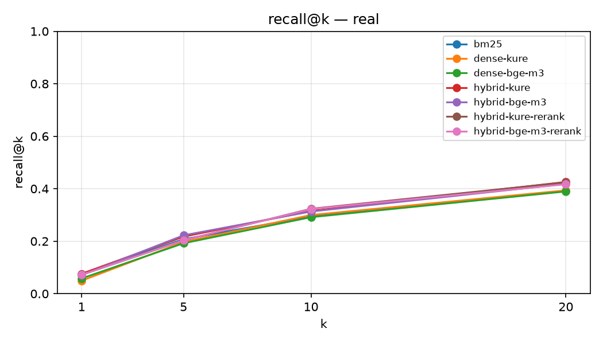

# 검색 설정별 결과

생성: 2026-10-27 10:55 · `rag_eval.report` 가 질의별 원자료에서 자동 생성

## 골든셋 `real` (질의 150건)

| 설정 | hit@1 | hit@10 | recall@10 | mrr | ndcg@10 | map | hit@10 95% CI (Wilson) | p95 지연(ms) |
|---|---|---|---|---|---|---|---|---|
| `bm25` | 0.520 | 0.827 | 0.294 | 0.629 | 0.452 | 0.313 | [0.758, 0.879] | 4.8 |
| `dense-kure` | 0.493 | 0.847 | 0.300 | 0.617 | 0.448 | 0.291 | [0.780, 0.896] | 35.2 |
| `dense-bge-m3` | 0.493 | 0.833 | 0.291 | 0.609 | 0.439 | 0.282 | [0.766, 0.884] | 38.1 |
| `hybrid-kure` | 0.560 | 0.840 | 0.315 | 0.662 | 0.488 | 0.336 | [0.773, 0.890] | 41.5 |
| `hybrid-bge-m3` | 0.560 | 0.833 | 0.313 | 0.653 | 0.482 | 0.328 | [0.766, 0.884] | 39.9 |
| `hybrid-kure-rerank` | 0.547 | 0.847 | 0.324 | 0.644 | 0.481 | 0.332 | [0.780, 0.896] | 4337.1 |
| `hybrid-bge-m3-rerank` | 0.547 | 0.847 | 0.323 | 0.645 | 0.483 | 0.330 | [0.780, 0.896] | 4322.0 |

### `dense-kure` 대비 hit@10 McNemar 검정

b = 해당 설정만 성공, c = 기준 설정만 성공

| 설정 | b | c | p | 방법 |
|---|---|---|---|---|
| `bm25` | 6 | 9 | 0.6072 | exact |
| `dense-bge-m3` | 2 | 4 | 0.6875 | exact |
| `hybrid-kure` | 6 | 7 | 1.0000 | exact |
| `hybrid-bge-m3` | 5 | 7 | 0.7744 | exact |
| `hybrid-kure-rerank` | 7 | 7 | 1.0000 | exact |
| `hybrid-bge-m3-rerank` | 7 | 7 | 1.0000 | exact |

